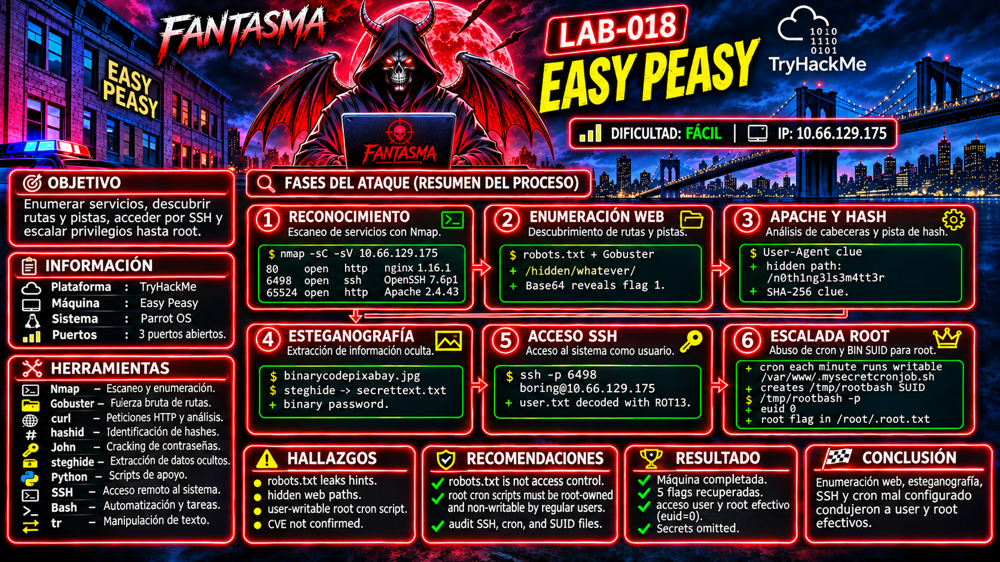

# FANTASMA | LAB-018 — EASY PEASY

**TryHackMe | FANTASMA LAB-018 EASY PEASY | Parrot OS, Nmap, Gobuster, hashid/John, steghide, SSH en 6498 y escalada por cron con script editable y Bash SUID | nginx 1.16.1, Apache 2.4.43 | user flag y root flag recuperadas; euid 0 confirmado | 3 puertos abiertos | CVE no confirmada**

| Dato | Valor |
|---|---|
| Plataforma | TryHackMe |
| Máquina | Easy Peasy |
| IP de la sesión | 10.66.129.175 |
| Dificultad | Fácil |
| Sistema atacante | Parrot Security OS |
| Resultado | 3 flags web, user flag y root flag recuperadas |
| Estado | Completada |
| CVE | No confirmada |

## Objetivo

Enumerar los servicios expuestos, descubrir las rutas ocultas, seguir las pistas de la web y de la imagen, acceder por SSH y revisar la configuración local hasta recuperar las flags de usuario y root.

## Descripción de la portada

Infografía panorámica con el avatar FANTASMA y la paleta neón roja del proyecto. Resume el objetivo, los tres puertos abiertos, las herramientas, las seis fases reales, los comandos clave, los hallazgos, las recomendaciones y el resultado. Las flags y credenciales se omiten de la versión pública.

## Servicios detectados

| Puerto | Servicio | Versión observada |
|---|---|---|
| 80/tcp | HTTP | nginx 1.16.1 |
| 6498/tcp | SSH | OpenSSH 7.6p1 Ubuntu 4ubuntu0.3 |
| 65524/tcp | HTTP | Apache httpd 2.4.43 (Ubuntu) |

## Ruta del laboratorio

1. **Reconocimiento:** Nmap confirmó tres puertos abiertos.
2. **Enumeración web:** robots.txt y Gobuster revelaron /hidden/ y una ruta profunda. Un contenido Base64 escondía la primera flag.
3. **Segundo servidor web:** el Apache del puerto 65524 expuso pistas en robots.txt, en la página inicial y en un User-Agent específico. La enumeración condujo al directorio oculto.
4. **Hash y esteganografía:** se identificaron pistas de hash y una imagen. Steghide extrajo secrettext.txt, que contenía el usuario boring y una contraseña escrita en binario.
5. **Acceso de usuario:** SSH funcionó en el puerto 6498. user.txt estaba codificado con ROT13.
6. **Escalada:** cron ejecutaba cada minuto como root un script modificable por boring. El script creó un Bash SUID en /tmp; con la opción -p se obtuvo euid 0 y se leyó /root/.root.txt.

## Hallazgos principales

- Dos servidores web distintos en puertos no estándar o alternativos.
- robots.txt y las rutas ocultas proporcionaban pistas directas de enumeración.
- La imagen del directorio oculto contenía datos recuperables con esteganografía.
- Un script propiedad del usuario boring era ejecutado como root por cron.
- La identidad efectiva pasó a root (euid=0); id conservó uid=1000(boring).
- La flag de root estaba en el archivo oculto /root/.root.txt.
- No se confirmó una CVE aplicable.

## Herramientas

Nmap, Gobuster, curl, wget, hashid, John the Ripper, steghide, Python 3, tr, SSH y Bash.

## Evidencias y documentos

- [Informe técnico](01-Informes/INFORME-TECNICO.md)
- [Reconocimiento](02-Reconocimiento/RECONOCIMIENTO.md)
- [Escalada y explotación](03-Explotacion/EXPLOTACION-Y-ESCALADA.md)
- [Descripción de la portada](04-Imagenes/README.md)
- [Evidencias públicas](05-Evidencias/publico/README.md)
- [Hallazgos](05-Evidencias/publico/hallazgos.md)
- [Comandos utilizados](06-Comandos/COMANDOS.md)

Los valores de las flags y las credenciales no están incluidos en la publicación. Se conservan en el directorio privado local, excluido por .gitignore.

## Recomendaciones

1. No dejar rutas, nombres internos ni credenciales implícitas en robots.txt o páginas públicas.
2. Retirar páginas por defecto y limitar el acceso a directorios que no deban publicarse.
3. Ejecutar los scripts de cron como root únicamente si son propiedad de root y no pueden modificarse por usuarios ordinarios.
4. Revisar con regularidad permisos, propietarios y tareas programadas.
5. Restringir SSH a cuentas necesarias y proteger las credenciales.

---

**FANTASMA | LAB-018 | EASY PEASY | Laboratorio completado**
